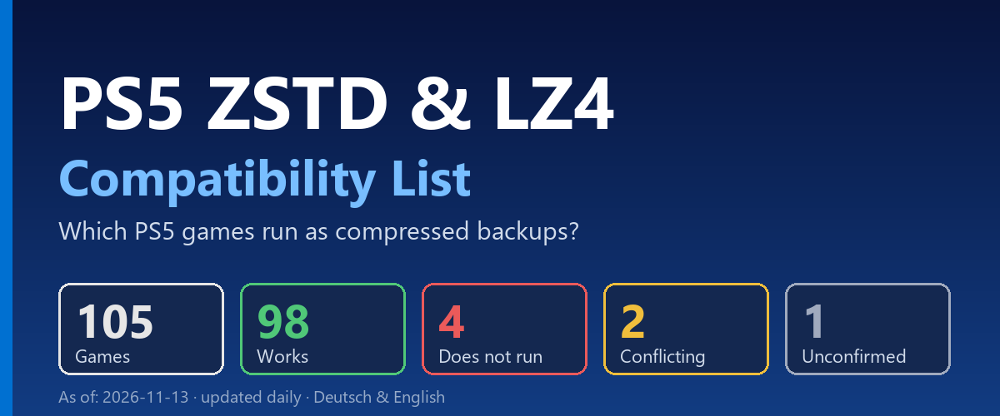

# PS5 ZSTD & LZ4 Compatibility List (English)

[Deutsch](README.md) | **English**

Overview of which PS5 games run as ZSTD- or LZ4-compressed backups (e.g. `.ffpfsc, .exFAT, .ffpkg`).
The list is updated automatically every day.

## Download

**[⬇ Download latest PDF (English)](https://github.com/strongt1me/ps5-zstd-kompatibilitaetsliste/releases/latest/download/PS5-ZSTD-LZ4-Compatibility-List.pdf)**
· **[⬇ Aktuelle PDF (Deutsch)](https://github.com/strongt1me/ps5-zstd-kompatibilitaetsliste/releases/latest/download/PS5-ZSTD-LZ4-Kompatibilitaetsliste.pdf)**

See the [CHANGELOG](CHANGELOG.en.md) for what is new. In the PDF, new and changed games are marked
`[NEW]` / `[CHANGED]` and highlighted in blue.

## Status: 2026-11-13

105 games

| Status | Count |
|---|---|
| Works | 98 |
| Does not run | 4 |
| Conflicting | 2 |
| Unconfirmed | 1 |

- **Works**: all test reports successful
- **Does not run**: all test reports failed
- **Conflicting**: reports with different results
- **Unconfirmed**: result unclear

## What is ZSTD?

Zstandard (ZSTD) is a lossless compression algorithm developed by Yann Collet at Facebook (now Meta) and open
source since 2016. It compresses about as well as zlib/gzip but decompresses much faster, which is ideal when
data is unpacked at runtime.

## What is LZ4?

LZ4 is also a lossless compression algorithm by the same author (Yann Collet). It is built for maximum speed:
LZ4 decompresses even faster than ZSTD but compresses less, so the files end up larger.

## Why does this matter for the PS5?

Game backups are compressed with ZSTD or LZ4 to save disk space. While playing, an emulator
for the AMPR interface (ampr-emu / libSceAmpr) decompresses the data in real time. This list shows which games
actually run in this compressed form. The "Format" column states which algorithm was used for the test.

## Note on muxi's tests

muxi packs all titles as exFAT images. This should not matter for whether a title works, but it is worth mentioning.

## Source and licence

Data: [PS5 ZSTD Compatibility Database](https://theweil.github.io/PS5-ZSTD-Compatibility/)
([GitHub](https://github.com/Theweil/PS5-ZSTD-Compatibility)), licence CC BY 4.0. Notes were translated from
Chinese; tester nicknames are as in the original. Own additions are in `data/manual.json` (e.g. Gothic 1 Remake,
tested by muxi) until the source lists them. Chinese notes without a translation in `data/translations_en.json`
are omitted.

Built with `python build.py` (requires `reportlab`).
