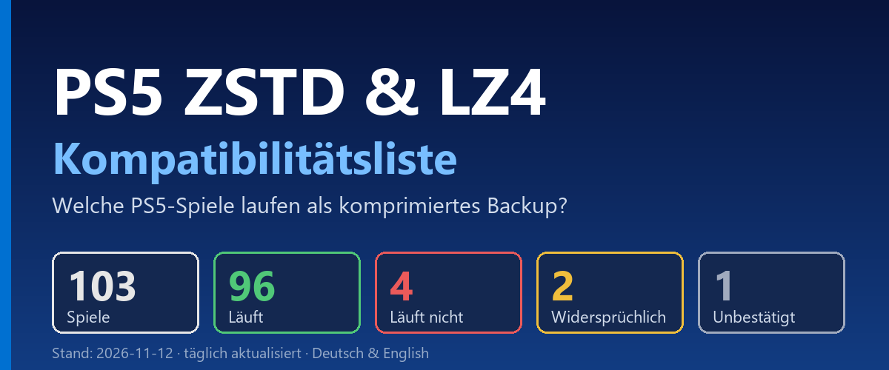

# PS5 ZSTD & LZ4 Kompatibilitätsliste (Deutsch)

**Deutsch** | [English](README.en.md)

Deutsche Übersicht, welche PS5-Spiele als ZSTD- oder LZ4-komprimiertes Backup (z. B. `.ffpfsc, .exFAT, .ffpkg, usw.`) laufen.
Die Liste wird täglich automatisch aktualisiert.

## Download

**[⬇ Aktuelle PDF herunterladen (Deutsch)](https://github.com/strongt1me/ps5-zstd-kompatibilitaetsliste/releases/latest/download/PS5-ZSTD-LZ4-Kompatibilitaetsliste.pdf)**
· **[⬇ Download latest PDF (English)](https://github.com/strongt1me/ps5-zstd-kompatibilitaetsliste/releases/latest/download/PS5-ZSTD-LZ4-Compatibility-List.pdf)**

Was neu ist, steht im [CHANGELOG](CHANGELOG.md). In der PDF sind neue und geänderte Spiele mit
`[NEU]` bzw. `[GEÄNDERT]` markiert und blau hinterlegt.

## Stand: 2026-11-12

103 Spiele

| Status | Anzahl |
|---|---|
| Läuft | 96 |
| Läuft nicht | 4 |
| Widersprüchlich | 2 |
| Unbestätigt | 1 |

- **Läuft**: alle Testberichte erfolgreich
- **Läuft nicht**: alle Testberichte fehlgeschlagen
- **Widersprüchlich**: Berichte mit unterschiedlichem Ergebnis
- **Unbestätigt**: Ergebnis unklar

## Was ist ZSTD?

Zstandard (ZSTD) ist ein verlustfreies Kompressionsverfahren, entwickelt von Yann Collet bei Facebook (heute Meta)
und seit 2016 Open Source. Es komprimiert ähnlich gut wie zlib/gzip, entpackt aber deutlich schneller. Das ist
ideal, wenn Daten zur Laufzeit entpackt werden.

## Was ist LZ4?

LZ4 ist ebenfalls ein verlustfreies Kompressionsverfahren und stammt vom selben Entwickler (Yann Collet).
Es ist auf maximale Geschwindigkeit ausgelegt: LZ4 entpackt noch schneller als ZSTD, komprimiert aber
schwächer, die Dateien werden also größer.

## Warum ist das für die PS5 wichtig?

Spiel-Backups werden mit ZSTD oder LZ4 komprimiert, damit sie weniger Speicherplatz brauchen.
Beim Spielen entpackt ein Emulator für die AMPR-Schnittstelle (ampr-emu bzw. libSceAmpr) die Daten
in Echtzeit. Die Liste zeigt, welche Spiele in dieser komprimierten Form tatsächlich laufen. In der Spalte
„Format“ steht, mit welchem Verfahren getestet wurde.

## Hinweis zu den Tests von muxi

muxi packt alle Titel grundsätzlich im exFAT-Image-Format. Das spielt für die Funktion eines Titels zwar keine Rolle,
ist aber erwähnenswert.

## Quelle und Lizenz

Daten: [PS5 ZSTD Compatibility Database](https://theweil.github.io/PS5-ZSTD-Compatibility/)
([GitHub](https://github.com/Theweil/PS5-ZSTD-Compatibility)), Lizenz CC BY 4.0. Hinweise wurden aus dem
Chinesischen übersetzt; Tester-Nicknames stehen im Original. Eigene Ergänzungen stehen in
`data/manual.json` (z. B. Gothic 1 Remake, Test von muxi), bis die Quelle sie führt.
Chinesische Hinweise, die noch keine Übersetzung in `data/translations.json` haben, werden ausgelassen.

Gebaut mit `python build.py` (benötigt `reportlab`).
